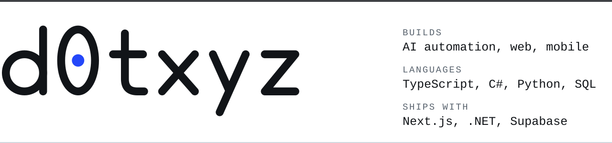
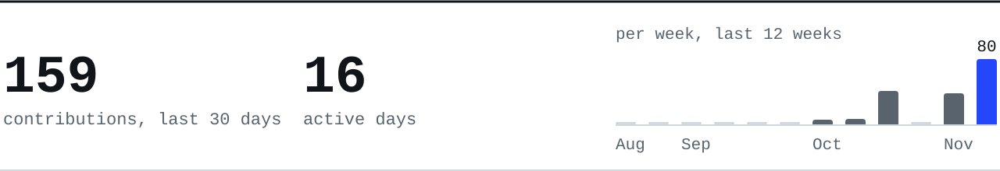

<picture>
  <source media="(prefers-color-scheme: dark)" srcset="assets/banner-dark.svg">
  
</picture>

I build full-stack products and the automation around them: web and mobile apps, AI agents, and the plumbing between systems. If a task gets done the same way every week, I would rather it ran by itself.

**Portfolio:** [d0txyz.github.io](https://d0txyz.github.io) · **Email:** [dr.n3far1ous@gmail.com](mailto:dr.n3far1ous@gmail.com) · Open to full-time or contract work, remote.

### What I do

<table>
  <tr><td><b>AI&nbsp;agents and automation</b></td><td>LLM pipelines with tool use and streaming, retrieval on pgvector with hybrid search, MCP servers, schema-checked output and evals. Workflow automation with n8n.</td></tr>
  <tr><td><b>Full-stack web</b></td><td>React and Next.js apps in TypeScript, from database schema to deploy. Bilingual and right-to-left interfaces.</td></tr>
  <tr><td><b>Backend and data</b></td><td>ASP.NET Core APIs with EF Core. Postgres and Supabase with row-level security. Background jobs, cron and webhooks.</td></tr>
  <tr><td><b>Payments and sign-in</b></td><td>Stripe, PayPal and Xendit checkout with webhooks. OAuth, one-time codes and role-based access.</td></tr>
  <tr><td><b>Mobile</b></td><td>Expo and React Native apps with push notifications and maps, Android packaging, installable PWAs.</td></tr>
  <tr><td><b>Integrations</b></td><td>Google Calendar, Gmail and Drive, email and SMS, Telegram alerts, web push.</td></tr>
  <tr><td><b>Shipping</b></td><td>Docker Compose on a VPS, Vercel, Netlify, GitHub Actions CI, and automated tests (xUnit, Vitest, pytest).</td></tr>
</table>

### Languages

<table>
  <tr><td><b>TypeScript</b></td><td>My main language: web apps, React Native, edge functions, agent tooling.</td></tr>
  <tr><td><b>C#</b></td><td>ASP.NET Core APIs, EF Core, xUnit.</td></tr>
  <tr><td><b>Python</b></td><td>LLM pipelines, FastAPI services, scrapers, image and data scripts.</td></tr>
  <tr><td><b>JavaScript</b></td><td>Framework-free sites, Canvas and three.js browser games, Node scripts.</td></tr>
  <tr><td><b>SQL</b></td><td>Postgres and pgvector, row-level security policies, MariaDB, SQLite.</td></tr>
  <tr><td><b>Rust</b></td><td>A spending-policy smart contract on NEAR, built at a hackathon.</td></tr>
  <tr><td><b>HTML and CSS</b></td><td>Tailwind CSS day to day, hand-written when the page is small.</td></tr>
</table>

### Lately

<picture>
  <source media="(prefers-color-scheme: dark)" srcset="assets/activity-dark.svg">
  
</picture>

Most of my work lives in private repos. This strip redraws itself every day from my contribution calendar.
